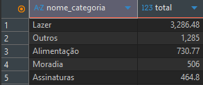
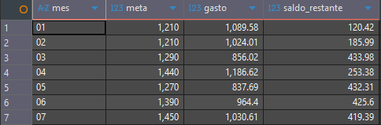

# Análise de Finanças Pessoais

> **Cenário:** Este projeto simula o trabalho de uma consultora de dados contratada para analisar as finanças pessoais de um cliente. O objetivo principal é identificar padrões de gastos, acompanhar metas financeiras e gerar insights acionáveis.

---

## Ferramentas Utilizadas

* **Banco de Dados:** PostgreSQL
* **Gerenciamento do Banco:** DBeaver
* **Controle de Versão:** Git & GitHub

---

## Modelo do Banco de Dados

O banco de dados foi modelado utilizando três tabelas principais:

- **Categorias:** classificação das receitas e despesas.
- **Transações:** registro de todas as movimentações financeiras.
- **Metas:** orçamento mensal definido para cada categoria.

---

## Consultas SQL

### Gasto por categoria

### Saldo financeiro

### Categorias que ultrapassaram a meta
