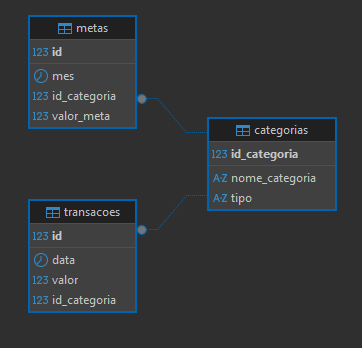

# Análise de Finanças Pessoais

## Este projeto simula o trabalho de uma consultora de dados contratada para analisar as finanças pessoais de um cliente. 

O objetivo é identificar padrões de gastos, acompanhar metas financeiras e gerar insights por meio de SQL, Python e Power BI.

**Ferramentas utilizadas**
- DBeaver
- PostgreSQL
- Git
- GitHub
...

**Modelo do banco**

**Consultas SQL**
Top 5 categorias com maior gasto
...

Gasto mensal
...

Categoria mais cara
...

